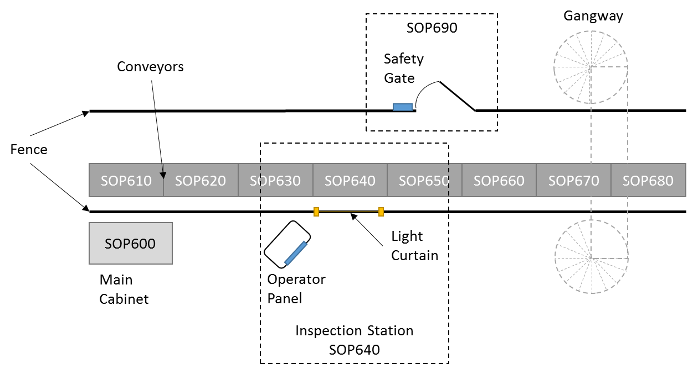
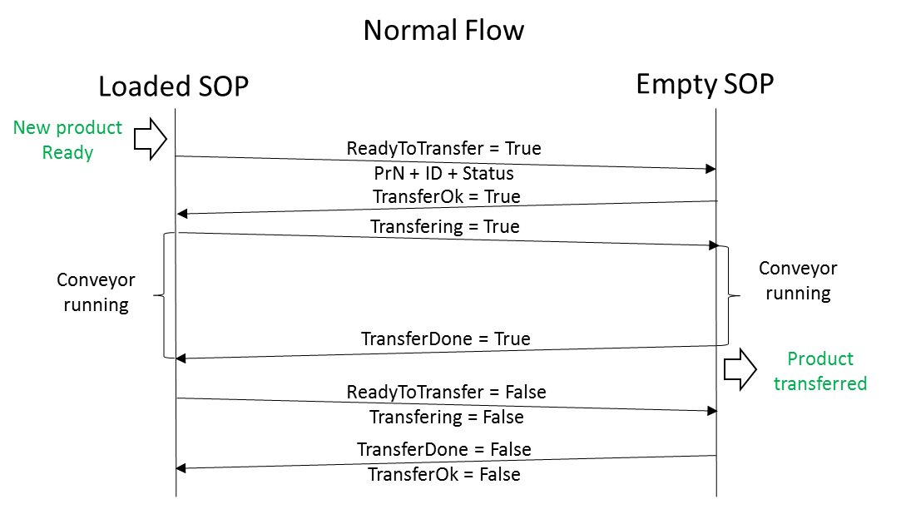
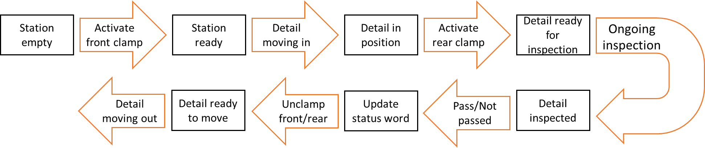

# OP10 station: CODESYS PLC, Simumatik digital twin and ABB RAPID robot

Virtual commissioning of a manufacturing station ("OP10") of a cylinder-head line. A CODESYS PLC program controls a 3D station modelled in Simumatik; the two exchange signals through an OPC UA server. An ABB IRB 6620 robot program in RAPID handles pick-and-place of three pieces. An I/O list documents the signal addressing.

University case with a fictional customer. Course PR313G Industrial Control Engineering, University of Skövde, 2021-22.

**Team project; I worked across the whole implementation.** Licence pending agreement with the team.

## Stack

CODESYS V3 (IEC 61131-3), OPC UA, Simumatik 3D, ABB RobotStudio / RAPID, Excel (I/O list).

## What is in the repository

| Path | Description | Opens with |
|---|---|---|
| `codesys/Final_Codesys_Projectv20.project` | Final PLC project (v20) | CODESYS V3 |
| `simumatik/Final_Simumatik.smk` | Final station model | Simumatik 3D |
| `simumatik/OPCUA Server.xml` | OPC UA server configuration for the robot signals (job done, tool on/off, piece present, halt, auto on) | Simumatik OPC UA server |
| `robotstudio/rapid/Module1.mod` | RAPID program: targets `Home`, `piece1`..`piece3`, `outputconveyor` | Text editor / RobotStudio |
| `io-list/IO-List-OP10.xlsx` | Signal list; inputs are addressed to the M area so they can be written through the CODESYS OPC UA server | Excel |
| `docs/media/` | Diagrams of the line layout, the OP50/OP60 handshake and the inspection-station sequence | Any image viewer |

## Diagrams

Line layout (stations SOP610-SOP680 and the inspection station SOP640):

Handshake between neighbouring operations (normal flow):

Inspection station sequence:

The diagrams come from the team's functional description, which is not included.

## Results

No measurements or graded results are in the files. The functional description specifies 11 conveyors at 24 cm/s, a transfer driven by a double-acting cylinder, a pick-up station with IR position sensing, a pallet stacker, safety gates, 2.5 m fencing and a light curtain. This repository does not show recordings of the twin running.

## How to run (and limits)

I have not re-run the project while preparing this repository. The tools are proprietary, so nothing here runs without them.

1. Open `codesys/Final_Codesys_Projectv20.project` in CODESYS V3 and enable its OPC UA server.
2. Open `simumatik/Final_Simumatik.smk` in Simumatik 3D and use `simumatik/OPCUA Server.xml` for the robot device.
3. The RobotStudio Pack&Go station isn't included; the RAPID module and the diagrams are. Load `robotstudio/rapid/Module1.mod` on an IRB 6620 controller in a station of your own.
4. Signal names and addresses are in `io-list/IO-List-OP10.xlsx`.

## Third-party and course material

- Simumatik standard components, the ABB IRB 6620 model and the Simumatik engine / HMI-panel models come from the vendor tools.
- The SOP6xx line naming, the HMI display image embedded in the `.smk` and the OP50/OP60 interface come from the course material or the vendor template; I have not separated them from the team's changes.
- A stock concrete texture that was embedded in the `.smk` was replaced by a plain grey image of the same file name.
- Three other concrete textures in the `.smk` have no recorded origin.
- Omitted: customer inquiry documents, earlier milestones, example projects, group reports, the RobotStudio Pack&Go and its controller backup and licence files.
- I could not inspect the `.project` file outside CODESYS (the format is a compressed binary). Check Project > Project Information before relying on it.
